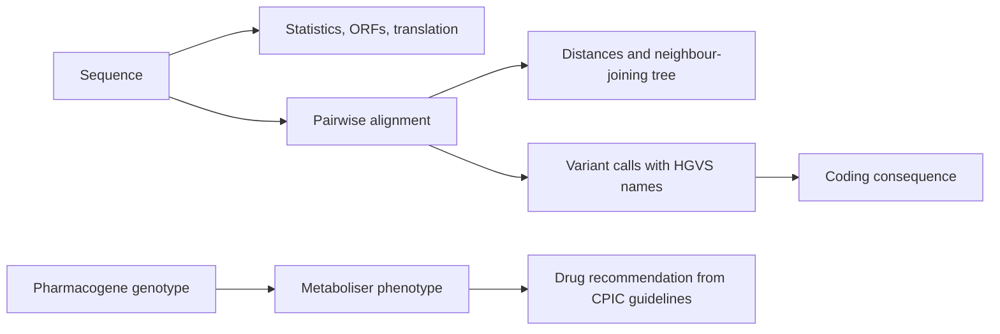

# Sequence Lab

Readable bioinformatics, from a raw sequence to a prescribing decision. Pure Python and NumPy, written from scratch so every step can be followed in the source.

[](https://github.com/itsgichia/sequence-lab/actions/workflows/ci.yml)

Live, interactive version: [the Sequence Lab on my portfolio](https://gichia-portfolio.vercel.app/lab/seq), which installs this package behind a FastAPI endpoint.

## Why

Bioinformatics toolkits hide the algorithms behind a command line. I wanted the core ones, the kind taught in a first bioinformatics course, in one small package where you can read what they do, with a path that goes all the way to personalised medicine: call a variant, work out what it does to the protein, and translate a patient's pharmacogene genotype into a dosing recommendation.



## What is in it

| Module | What it does |
|---|---|
| `seqlab.sequence` | FASTA parsing, DNA/protein detection, reverse complement, translation with the standard codon table, six-frame ORF finding, composition, GC content and GC sliding window, protein mass and hydrophobic/charged fractions |
| `seqlab.align` | Needleman-Wunsch global and Smith-Waterman local alignment with linear gap penalties. The row recurrence is vectorised with a cumulative maximum, so a 1,500 x 1,500 alignment takes about 25 ms |
| `seqlab.tree` | p-distance and Jukes-Cantor distances from pairwise alignments, Saitou-Nei neighbour joining, Newick export and a layout for drawing |
| `seqlab.variants` | Calls substitutions, insertions and deletions between a reference coding sequence and a sample, names them in HGVS form (`c.34C>A`, `c.73_75del`, `p.Gln12Lys`, `p.Lys69fs`) and classifies the consequence: synonymous, missense, nonsense, stop lost, start lost, in-frame indel, frameshift |
| `seqlab.pgx` | Pharmacogenomics tables for CYP2C19, CYP2D6, TPMT and SLCO1B1: allele function, CYP2D6 activity score, diplotype to phenotype, and paraphrased CPIC recommendations for clopidogrel, omeprazole, codeine, ondansetron, azathioprine and simvastatin, each linked to its guideline |
| `seqlab.examples` | Synthetic data with known answers: a gene family whose true tree is known, and a reference/sample pair carrying one variant of each class |

## Install and run

```bash
pip install "seqlab @ https://github.com/itsgichia/sequence-lab/archive/refs/tags/v0.1.0.tar.gz"
# or, for development
git clone https://github.com/itsgichia/sequence-lab && cd sequence-lab
python -m venv .venv && source .venv/bin/activate && pip install -e ".[dev]" && pytest -q
```

```bash
seqlab examples --out examples/                 # write the bundled example files
seqlab stats examples/gene.fa
seqlab align examples/gene.fa examples/sample_cds.fa --mode local
seqlab tree examples/family.fa                  # prints Newick
seqlab variants examples/reference_cds.fa examples/sample_cds.fa
seqlab pgx CYP2C19 '*1' '*2'
seqlab --json pgx CYP2D6 '*4' '*10'
```

The variant call on the bundled example gives one of each class:

```
c.15C>T            p.Ser5=                  synonymous
c.34C>A            p.Gln12Lys               missense
c.73_75del         p.Ile25del               in-frame deletion
c.180C>G           p.Tyr60Ter               nonsense
c.206_207insT      p.Lys69AsnfsTer?         frameshift
```

And the pharmacogenomics report:

```
CYP2D6 *4/*10: Intermediate metaboliser
activity score 0.25

Codeine: Use the label dose. If there is no response, consider a non-codeine
opioid; avoid tramadol as the alternative.
  (CPIC guideline for CYP2D6, OPRM1 and COMT and opioid therapy (2021))
```

From Python:

```python
from seqlab import align, call_variants, report, tree

al = align("GATTACA", "GCATGCU", match=1, mismatch=-1, gap=-1)   # score 0, the textbook example
calls = call_variants(reference_cds, sample_cds)                 # list of dicts with cdna, protein, consequence
rx = report("SLCO1B1", "T", "C")                                 # decreased function; simvastatin advice
```

## How the pieces work

**Alignment.** The dynamic programming matrix is filled one row at a time. For row *i*, the diagonal and vertical moves depend only on row *i-1* and are computed for every column at once. The horizontal move (a gap running along the row) is `max_k<=j (best[k] + gap*(j-k))`, which becomes a cumulative maximum once `gap*j` is factored out. The traceback recomputes which move produced each cell rather than storing pointers.

**Tree.** Each pair of sequences is aligned globally; the p-distance is the fraction of aligned, ungapped positions that differ, and the Jukes-Cantor correction `d = -3/4 ln(1 - 4p/3)` accounts for multiple hits. Neighbour joining then repeatedly joins the pair minimising the Q criterion. On the synthetic family the two clades and the outgroup are recovered, which the test suite checks.

**Variants.** A global alignment with a slightly higher gap penalty than the default separates substitutions from indels cleanly. Runs of alignment columns become one variant each, in reference coordinates. To classify a variant it is applied to the reference alone and both coding sequences are translated: a changed residue is missense, a new stop is nonsense, a length change not divisible by three is a frameshift, and so on. Notation follows HGVS conventions with three-letter amino acid codes.

**Pharmacogenomics.** CYP2C19 and TPMT use the CPIC function-pair table (two no-function alleles give a poor metaboliser, one gives an intermediate metaboliser, and so on). CYP2D6 uses the activity-score system: each allele has a value (1 for normal, 0.5 or 0.25 for decreased, 0 for no function, doubled for a duplication) and the sum sets the phenotype. SLCO1B1 is entered as the rs4149056 genotype directly, since that single missense change carries most of the clinically used information.

## Limits and honesty

- Scoring uses simple match/mismatch/gap values rather than substitution matrices or affine gaps, so this is a teaching tool, not a replacement for BLAST, MAFFT or IQ-TREE.
- Variant calling assumes the sample is the same gene as the reference and is read from the start codon; it does not handle genomic coordinates, splice sites or untranslated regions.
- The pharmacogenomics tables cover a handful of alleles per gene and paraphrase the guidelines. Real reports consider many more alleles, structural variants and phasing, and the guidelines are revised as evidence changes. **Nothing here is medical advice.** The CPIC guidelines themselves are at https://cpicpgx.org/guidelines/.
- Size limits (5,000 residues per sequence, 12 sequences of up to 1,500 residues per tree) keep every call under about 1.5 seconds on a laptop.

## Layout

```
seqlab/sequence.py   parsing, statistics, translation, ORFs
seqlab/align.py      pairwise alignment
seqlab/tree.py       distances, neighbour joining, Newick, layout
seqlab/variants.py   variant calling and coding consequences
seqlab/pgx.py        pharmacogene tables, phenotypes and recommendations
seqlab/examples.py   synthetic examples with known answers
seqlab/cli.py        command line entry point
tests/               pytest suite (runs in CI on Python 3.10 and 3.12)
```

## References

- Needleman SB, Wunsch CD. A general method applicable to the search for similarities in the amino acid sequence of two proteins. *J Mol Biol* 1970.
- Smith TF, Waterman MS. Identification of common molecular subsequences. *J Mol Biol* 1981.
- Saitou N, Nei M. The neighbor-joining method: a new method for reconstructing phylogenetic trees. *Mol Biol Evol* 1987.
- den Dunnen JT, et al. HGVS recommendations for the description of sequence variants: 2016 update. *Hum Mutat* 2016.
- Caudle KE, et al. Standardizing CYP2D6 genotype to phenotype translation: consensus recommendations from CPIC and DPWG. *Clin Transl Sci* 2020.
- Clinical Pharmacogenetics Implementation Consortium guidelines: https://cpicpgx.org/guidelines/

## Author

Gichia Muiruri, Master of Science (Health Data Science), UNSW Sydney. [LinkedIn](https://www.linkedin.com/in/gichia-muiruri) · [GitHub](https://github.com/itsgichia)
